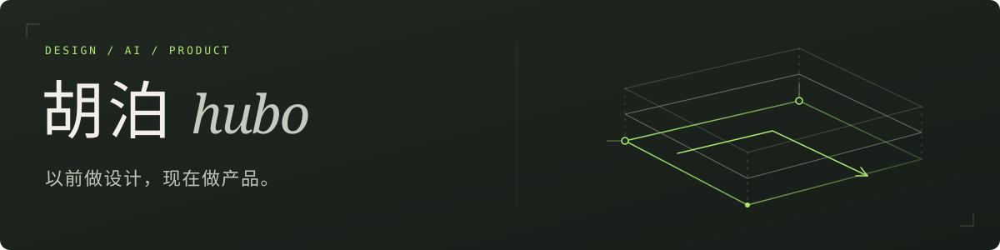

<picture>
  <source media="(max-width: 600px)" srcset="assets/profile-mobile.svg">
  
</picture>

我是胡泊（hubo），AI 产品经理。以前做设计，现在围绕 Agent 和 AI 应用做产品、写工具，也记录过程中的判断。

我关心的是：一个想法怎么变成可用的产品，以及 AI 到底帮用户省了多少事。

**[产品手记 ↗](https://hubooooooo.github.io/ai-pm-articles/)** · [全部仓库](https://github.com/hubooooooo?tab=repositories) · [学习路线](https://github.com/hubooooooo/claude-code-harness-study/blob/main/学习路线总导读.md)

## 精选项目

### [Agent Workshop · Agent 工坊](https://github.com/hubooooooo/agent-workshop)

把点子整理成 PRD、架构方案与验收依据，交给编码 AI 实现，再继续迭代。也可以从已有项目反查需求与实现之间的差距。

### [Personal Agent · 个人助理底座](https://github.com/hubooooooo/Personal-Agent)

带长期记忆、工具调用和多渠道接入的个人助理。把记忆管理、操作确认和二次开发放进同一套底座里。

### [ShortFilm Agent · AIGC 内容生产](https://github.com/hubooooooo/shortfilm-agent)

用场景包组织图像与视频生产，覆盖短片、广告、漫剧、文旅和海报。每个阶段都可以查看、确认、修改和重做。

## 从理解到落地

一门课，两个项目，串起完整的实践路线：

**[理解 Agent](https://github.com/hubooooooo/claude-code-harness-study)** → **[形成产品方案](https://github.com/hubooooooo/agent-workshop)** → **[开发与上线](https://github.com/hubooooooo/idea-to-launch-kit)**

先理解组件与边界，再把需求整理清楚，最后借助编码 AI 做出自己的产品。[路线与交接说明 ↗](https://github.com/hubooooooo/claude-code-harness-study/blob/main/学习路线总导读.md)

## 更多探索

- **[拆拆 ChaiChai](https://github.com/hubooooooo/chaichai)** — 让 AI 帮你拆解软件，理解它怎么运作。
- **[Paper Reading](https://github.com/hubooooooo/Paper-Reading)** — 英文论文的导读、翻译、术语整理与问答。
- **[FDE 上海分享](https://github.com/hubooooooo/FDE-Shanghai-2026-Share)** — 分享会逐字稿与七步案例资料。
- **[Founder's Playbook 中文教学版](https://github.com/Innate-Labs/founders-playbook)** — Innate Labs 的 Anthropic 创业手册中文教学资料。

---

常用工具与技术：Python · TypeScript · FastAPI · LangGraph · Figma · AI 编程工具
